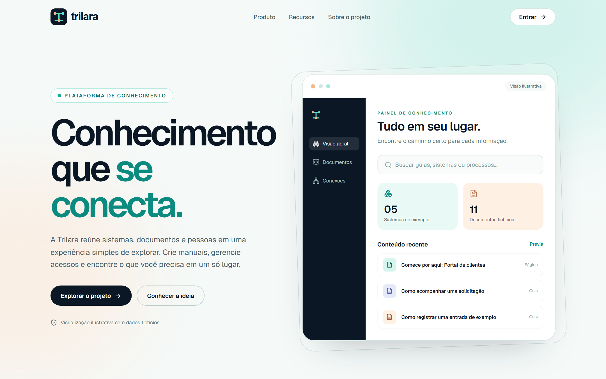
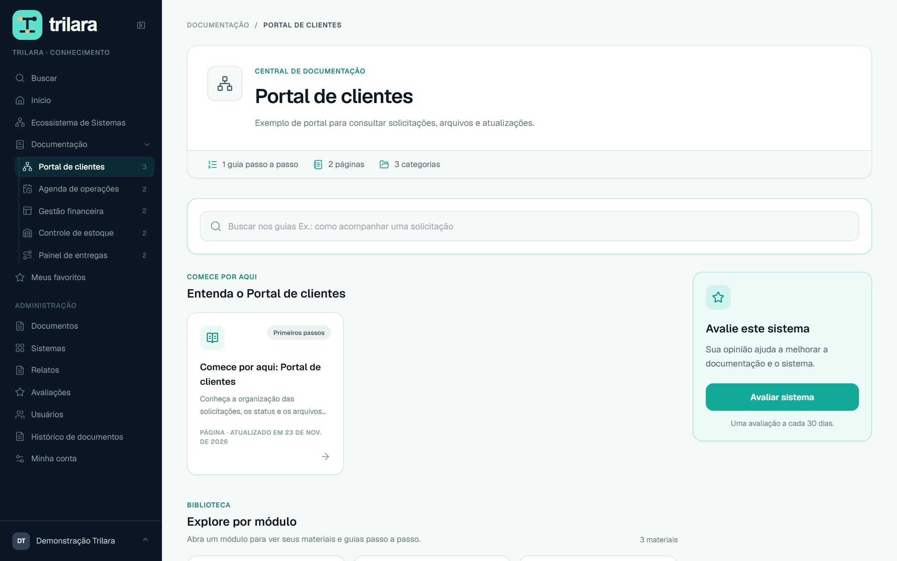
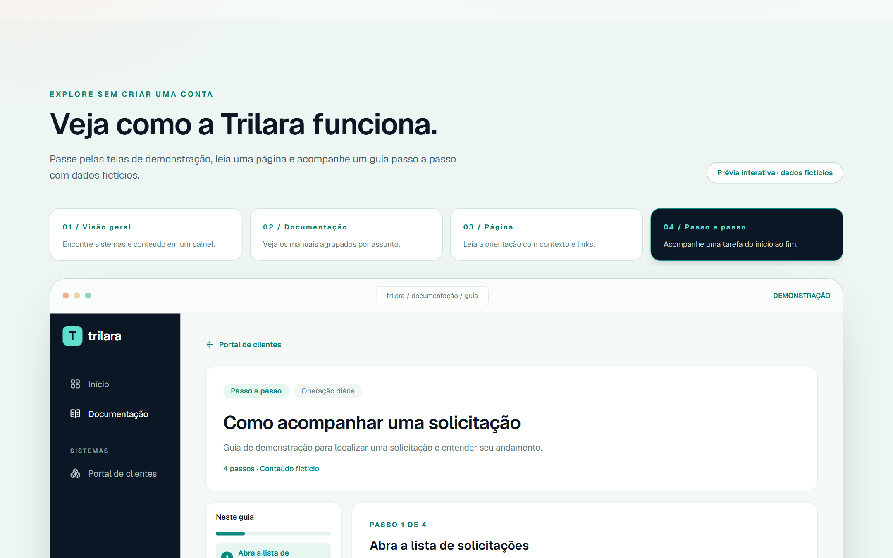

# Trilara

**Conhecimento conectado para quem precisa entender sistemas e executar processos.**

A Trilara reúne catálogo de sistemas, manuais e pessoas em um só lugar. Em vez de procurar orientações em arquivos dispersos, a pessoa encontra o sistema, consulta a documentação e acompanha um procedimento passo a passo. Quem administra o portal pode manter os conteúdos e os acessos atualizados pela própria interface.

**[Explore a demonstração pública](https://trilara-rho.vercel.app)** — navegue pelo projeto com exemplos fictícios, sem criar conta.

A [página de apresentação](src/app/page.tsx) permite explorar uma demonstração interativa sem criar conta. Ela usa dados fictícios. O portal completo, com documentos e ferramentas de gestão, exige login.



## O que o sistema faz

| Área | O que você encontra |
| --- | --- |
| **Sistemas** | Catálogo com informações de cada ferramenta e uma visão das conexões entre elas. |
| **Documentação** | Biblioteca organizada por sistema, seção e categoria, com busca para localizar o conteúdo. |
| **Manuais** | Páginas de orientação, artigos, arquivos e guias passo a passo com etapas e caminhos de acesso. |
| **Uso diário** | Painel inicial, conteúdos em destaque, favoritos e acesso rápido aos manuais. |
| **Gestão** | Cadastro e edição de sistemas e documentos, publicação de conteúdo, usuários, papéis e permissões. |
| **Acesso** | Solicitação de conta, análise pelo administrador, login e recuperação de senha. |

### Um exemplo de uso

1. A pessoa abre o catálogo e escolhe o sistema que precisa usar.
2. Na documentação desse sistema, busca um assunto ou abre o conteúdo **Comece por aqui**.
3. Se a tarefa tiver várias etapas, segue um guia passo a passo com instruções e caminhos dentro do sistema.
4. Um editor pode atualizar o manual, enquanto a administração controla publicação e acesso.

A demonstração pública percorre uma visão geral, a biblioteca, uma página e um guia com dados inventados. As telas abaixo mostram essa experiência:

| Biblioteca de manuais | Guia passo a passo |
| --- | --- |
|  |  |

O projeto inclui exemplos fictícios de sistemas e documentos para apresentação. O assistente dos manuais está **desativado**; seu código foi preservado para avaliação futura.

## Para quem foi pensado

A Trilara pode ajudar equipes que usam várias ferramentas e precisam explicar como elas funcionam, registrar procedimentos e manter uma referência acessível para novos usuários. O conteúdo e as permissões são gerenciados dentro do portal, de acordo com o papel de cada pessoa.

Este é um projeto pessoal em desenvolvimento. A página pública apresenta o conceito; algumas opções só aparecem após o login e dependem das permissões da conta.

## Tecnologias

Next.js, React, TypeScript, Prisma e PostgreSQL. Os documentos enviados ficam em armazenamento privado; o projeto aceita armazenamento local no desenvolvimento e S3 quando configurado.

## Rodar localmente

Requisitos: Node.js 20 ou superior e Docker Desktop com PostgreSQL.

```powershell
Copy-Item .env.example .env
npm ci
npm run db:up
npm run db:deploy
npm run dev
```

Defina uma `SESSION_SECRET` aleatória no `.env` antes de entrar. Abra http://localhost:3002. A migração `20261124000000_trilara_baseline` prepara um banco novo. Se você já usa um banco local criado com as migrações históricas, preserve-o e não execute `db:deploy` nele; use um banco vazio para testar uma instalação nova.

Não há login padrão. Depois de preparar o banco, crie o primeiro administrador:

```powershell
npm run colaborador -- voce@exemplo.com "Seu Nome" senha-forte ADMIN
```

Outras pessoas podem solicitar acesso com nome, e-mail e senha. O administrador aprova os pedidos em **Administração → Usuários → Liberações de acesso**.

Para criar sistemas e documentos de exemplo em um banco local `trilara` na porta 5435, execute `npm run demo:documentos`.

### Recuperação de senha

Configure `SMTP_SERVER`, `SMTP_PORT`, `SMTP_USERNAME`, `SMTP_PASSWORD`, `RESET_EMAIL_FROM` e `RESET_BASE_URL` para enviar links de redefinição. Sem SMTP no ambiente local, execute `npm run senha:local -- voce@exemplo.com`. O comando mostra um link privado de uso único válido por 30 minutos.

## Identidade e divulgação

A [identidade visual](docs/identidade-trilara.md) explica o nome, o logo e as cores. As [imagens para divulgação](materiais/linkedin/) estão prontas para apoiar uma publicação. A página de apresentação está hospedada na Vercel; `TRILARA_SITE_PUBLICO=true` mantém as rotas internas e APIs indisponíveis nesse deploy. `NEXT_PUBLIC_SITE_URL` aponta para o endereço público nos metadados de compartilhamento.

## Estado do projeto

O código é público, e o projeto pessoal continua em desenvolvimento. O site publicado apresenta somente a demonstração fictícia. Para publicar o portal completo, também são necessários PostgreSQL, sessão segura, SMTP e armazenamento persistente para os arquivos enviados. Em produção, uploads de PDF exigem ClamAV por `PDF_ANTIVIRUS_SOCKET`.

Arquivos `.env`, banco local, documentos enviados, backups e arquivos de ferramentas de IA ficam fora do Git.
